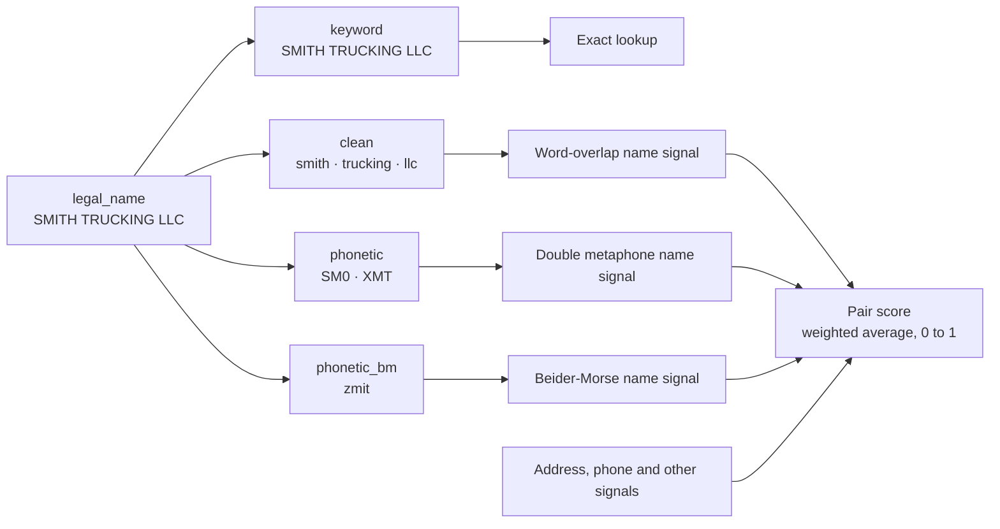

# Use Elasticsearch to match businesses when the data differs deliberately or accidentally

Entity resolution determines whether two listings in your systems are the same
real-world business. Two things make it hard: data quality and human
ingenuity. A sales team finds the same customer on two accounts:
`QUILLBY FREIGHT LLC` on one and `QUILBY FREIGHT INC` on the other. Both sit at
the same street, written two ways. A buyer's vendor list carries one supplier three
times. A regulator wants to know whether a trucking company it shut down has
reopened under a new name. That company may be working to avoid detection.
Either way, the names and addresses rarely match letter for letter.

[entitopia](https://github.com/freemansoft/entitopia) is an open-source project
for this kind of entity resolution on Elasticsearch. Two sample projects test
the idea on public data. One reads the US register of motor carriers, about 2.1
million companies, and looks for carriers that reopened under a new identity.
The other reads the Medicare list of 5,419 hospitals and looks for duplicate
listings. Both projects run in the same two stages:

1. An Elasticsearch search fetches the listings that may be the same business
   as each one, so nothing has to compare every listing with every other.
2. A Python scorer combines a score per field, called a signal, into one score
   for the pair.

Choosing how to match each field takes three steps. This article measures them
on names, and the same steps apply to addresses and other fields:

1. Choose a matching method by the kind of difference you expect between two
   listings of one business.
2. Test it against the near-miss values your search returns, because a test on
   random values makes every method look good.
3. Run the full match with the method and without it, and compare the pairs each
   run finds.

The figures come from public US government data downloaded in August 2026.
Expect different values on your own data.

The sections below look at each tuning knob in turn and measure its actual
impact.

## Terms used in this article

<details>
<summary>Show the terms</summary>

| Term                                                      | What it means here                                                                                                                                                                                                      |
| --------------------------------------------------------- | ----------------------------------------------------------------------------------------------------------------------------------------------------------------------------------------------------------------------- |
| Index                                                     | Elasticsearch's name for a collection of stored listings and their searchable forms. It is closer to a database table than to a database index. `carriers-000001` is the carrier index.                                 |
| Mapping                                                   | An index's schema: which fields it has, each field's type, and which analyzer processes each one.                                                                                                                       |
| Analyzer                                                  | Elasticsearch's rules for turning text into the pieces it stores and searches, called tokens: split into words, lowercase, drop punctuation, replace synonyms, encode sounds. It runs as each listing is stored.        |
| Tokenizer                                                 | The first step of an analyzer, which splits text into tokens. A standard tokenizer splits on spaces and punctuation; a keyword tokenizer keeps the whole value as one token.                                            |
| Filter                                                    | A later step of an analyzer that changes, removes or adds tokens: lowercasing, a stop filter that drops listed words, a synonym filter, a phonetic encoder.                                                             |
| Multi-field / subfield                                    | One source value stored several ways at once. Each stored version is a subfield, with its own analyzer and its own name, such as `legal_name.clean` for the cleaned words or `legal_name.phonetic` for the sound codes. |
| `keyword`                                                 | A field type stored exactly as written, as one token, for exact matching.                                                                                                                                               |
| Phonetic encoder                                          | An analyzer filter that replaces a word with a code for how it sounds, so `SMITH` and `SMYTH` produce the same code.                                                                                                    |
| Double metaphone                                          | A phonetic encoder for English that gives each word a primary and an alternate code. In its codes, `0` stands for the "th" sound, so `SMITH` becomes `SM0`.                                                             |
| Beider-Morse                                              | A phonetic encoder built for surnames across languages. This project limits it to English and Spanish.                                                                                                                  |
| Signal                                                    | One per-field comparison in the scorer, such as name sound codes or a shared phone number, returning a score from 0 to 1 or no value when the field is missing.                                                         |
| Embedding model                                           | A machine-learning model, not a chat assistant or language model, that turns a piece of text into a list of numbers so that similar text gets similar numbers.                                                          |
| Vector search                                             | Search that finds text whose embedding-model numbers lie close to the query's, in place of matching words.                                                                                                              |
| Edit distance                                             | The number of single-letter insertions, deletions or substitutions that turn one string into another.                                                                                                                   |
| `fuzziness: AUTO`                                         | Elasticsearch's setting for matching words within a few edits: none for words of one or two letters, one edit up to five letters, two beyond that. The project's `AUTO:4,6` allows no edit up to three letters.         |
| Sweep                                                     | One full run of the matcher over every listing, writing the pairs it finds to a new index.                                                                                                                              |
| Character trigrams                                        | Every run of three letters in a string: `SMITH` has `SMI`, `MIT` and `ITH`. Two strings sharing most of their trigrams are spelled alike.                                                                               |
| Candidate search                                          | The Elasticsearch query the project runs to fetch possible matches for a listing, before any scoring.                                                                                                                   |
| Look-alike                                                | A different name that a plain Elasticsearch name search returns for the original name, standing in for the candidate search.                                                                                            |
| Altered copies caught when at most 1% of look-alikes pass | Set the threshold so at most one look-alike in a hundred scores above it; the share of altered copies that also score above it. Statisticians call this recall.                                                         |
| `_analyze`                                                | The Elasticsearch API that returns the tokens an analyzer produces for a piece of text.                                                                                                                                 |
| Normalization                                             | Tidying a value before comparing it: changing case, removing punctuation, cutting a phone number to its digits.                                                                                                         |
| More terms                                                | The project's [README glossary](https://github.com/freemansoft/entitopia/blob/main/README.md#glossary) defines these and the rest of its vocabulary.                                                                    |

</details>

## Elasticsearch analyzers let you declare which spellings are equal

Two approaches can decide that two spellings name the same business. The table
compares the rules you declare in an Elasticsearch analyzer with the similarity
an embedding model learned for vector search.

|                             | Elasticsearch analyzer                                                                    | Embedding model                                                             |
| --------------------------- | ----------------------------------------------------------------------------------------- | --------------------------------------------------------------------------- |
| Where the equivalences live | In configuration: `st`, `str` and `strt` mean `street`; `LLC` and `INC` carry no identity | In the embedding model's weights, learned in training                       |
| Who decides them            | You, in one reviewable file                                                               | The embedding model                                                         |
| Fixing a wrong one          | Change a line                                                                             | Retrain or replace the embedding model                                      |
| What gets compared          | Each field, analyzed its own way                                                          | Whatever you choose to embed: one field, or the whole listing as one string |
| Measured in this article    | Yes                                                                                       | No                                                                          |

The project uses analyzers, because each equivalence stays readable and easy to
change.

## Store each field several ways, each tuned for one use

Elasticsearch can store one value several times, each copy processed by its own
analyzer and named as a subfield. The carrier index keeps each name four ways,
from
[`index-mappings.json`](https://github.com/freemansoft/entitopia/blob/main/DOT-Commercial/configuration/carriers/index-mappings.json):

```json
"legal_name": {
  "type": "text",
  "fields": {
    "keyword": { "type": "keyword" },
    "clean": { "type": "text", "analyzer": "name_clean" },
    "phonetic": { "type": "text", "analyzer": "name_phonetic" },
    "phonetic_bm": { "type": "text", "analyzer": "name_phonetic_bm" }
  }
}
```

Each matching method reads the subfield that suits it:

| Subfield                 | Holds                                              | Used for                                     |
| ------------------------ | -------------------------------------------------- | -------------------------------------------- |
| `legal_name.keyword`     | The name exactly as written                        | Exact lookups                                |
| `legal_name.clean`       | Its words, lowercased, punctuation removed         | Word overlap                                 |
| `legal_name.phonetic`    | Double metaphone sound codes, common words removed | Sound-alike matching                         |
| `legal_name.phonetic_bm` | Beider-Morse sound codes, common words removed     | Sound-alike matching for English and Spanish |

The diagram follows one carrier's name into its four subfields. The live carrier
index returns the tokens shown under each subfield name. Each name signal
compares those tokens with the same subfield of the other listing in the pair.
The scorer combines the name signals and the other signals into one weighted
average, the pair score, from 0 to 1. The `keyword` copy feeds no signal.



## Every matcher looks good against random names

A good matching method scores two versions of one business higher than two
unrelated businesses. Testing that needs both kinds of pair.

A real name and an altered copy of it stand in for two versions of one
business.
[`compare_name_matchers.py`](https://github.com/freemansoft/entitopia/blob/main/scripts/compare_name_matchers.py)
samples 400 legal names from the carrier index and makes up to seven altered
copies of each, 2,184 in all. The script generates the copies, so the figures
measure its changes rather than real renames.

Unrelated businesses come in two kinds. The kind you test against changes how
well each method seems to work:

1. A random name: another carrier picked at random. It shares almost nothing
   with the original, so it makes an easy test.
2. A look-alike: another carrier that a plain name search returns for the
   original. It shares a surname, a place word or a trade word, so it makes a
   hard test. The script takes up to five per name, 1,987 in all. Some may
   belong to related businesses.

The following table scores each method by a figure called AUC. Pick at random
one name with its altered copy, and one name with an unrelated name. AUC is the
chance the method scores the first pair higher. A score of 1.00 means it always
does, and 0.50 is a coin flip. Higher is better in every column.

| Matcher                          | How it compares two names           | Ranks against a random name (AUC) | Ranks against a look-alike (AUC) | Altered copies caught when at most 1% of look-alikes pass |
| -------------------------------- | ----------------------------------- | --------------------------------- | -------------------------------- | --------------------------------------------------------- |
| Double metaphone                 | Overlap of phonetic codes           | 0.981                             | 0.785                            | 0.0%                                                      |
| Beider-Morse                     | Overlap of phonetic codes           | 0.972                             | 0.718                            | 0.0%                                                      |
| Exact tokens                     | Overlap of normalized words         | 0.998                             | 0.755                            | 19.1%                                                     |
| Fuzzy tokens (`fuzziness: AUTO`) | Words equal within one or two edits | 0.999                             | 0.887                            | 52.4%                                                     |
| Edit distance                    | Whole normalized name               | 0.977                             | 0.852                            | 31.0%                                                     |
| Character trigrams               | Shared three-letter runs            | 1.000                             | 0.932                            | 12.7%                                                     |

A random name differs from the original in almost every letter, so every method
scores 0.97 to 1.00 against it. That test cannot separate them. Look-alikes
spread the scores from 0.72 to 0.93, and the differences between methods show.

The last column shows how many real matches each method catches while making
very few mistakes. The test holds 2,184 altered copies, which should match. It
also holds 1,987 look-alikes, which should not. Each method scores every pair
from 0 to 1, and pairs above a cut-off count as matches. The script sets the
cut-off so that at most 20 look-alikes, one in a hundred, score above it. The
column gives the share of altered copies that also score above it. Fuzzy tokens
catch 52.4%, about 1,144 of 2,184.

Both phonetic encoders catch none. The phonetic subfields drop common words, so
`QUILLBY TRUCKING LLC` and `QUILLBY TRANSPORT INC` both encode to `KLP` and
score a perfect 1.0. Roughly one look-alike in nine ties at 1.0 this way. No
cut-off can split pairs with equal scores, so any cut-off below 1.0 lets all of
them through. Stopping them takes a cut-off of 1.0, the highest possible score,
so no altered copy clears it either. A phonetic name match could not decide a
pair alone on this data; it needs an address, a phone or another field beside
it.

Trigrams rank best overall but keep only 12.7% at the strict cut-off, because
their top-scoring look-alikes score above most altered copies.

## Each matcher handles some name changes well and others badly

Choose a matcher by the name changes it gets right, not by its overall score.
The table breaks the look-alike AUC down by name change, from the same run.

| Name change         | Double metaphone | Beider-Morse | Exact tokens | Fuzzy tokens | Edit distance | Trigrams |
| ------------------- | ---------------- | ------------ | ------------ | ------------ | ------------- | -------- |
| Typo (one letter)   | 0.446            | 0.328        | 0.598        | 0.999        | 0.996         | 0.947    |
| Transposition       | 0.718            | 0.349        | 0.595        | 0.852        | 0.975         | 0.898    |
| Phonetic respelling | 0.882            | 0.878        | 0.625        | 0.909        | 0.995         | 0.966    |
| Abbreviation        | 0.292            | 0.294        | 0.578        | 0.576        | 0.910         | 0.892    |
| Word dropped        | 0.844            | 0.829        | 0.920        | 0.918        | 0.771         | 0.883    |
| Words reordered     | 0.946            | 0.949        | 1.000        | 0.999        | 0.492         | 0.965    |
| Suffix changed      | 0.946            | 0.949        | 0.767        | 0.764        | 0.942         | 0.939    |

What each name change does:

- **Typo (one letter).** It pushes both phonetic encoders below a coin flip. The
  typo changes the sound code, while a look-alike with the same surname keeps
  it. Fuzzy tokens and edit distance shrug it off.
- **Transposition.** Swapped neighboring letters hurt Beider-Morse most (0.349).
  Edit distance sees two changed letters and scores 0.975.
- **Phonetic respelling.** These changes follow phonetic rules (`PH` to `F`, `CK`
  to `K`), so they favor the phonetic encoders by construction. Edit distance
  still scores them higher (0.995 against 0.882 and 0.878).
- **Abbreviation.** `TRANSWORLD` cut to `TRAN` shares no word with the original
  and is more than two edits away, so every word-based method fails. Only the
  whole-name methods credit the shared start.
- **Word dropped.** The remaining words still match, and most methods score 0.83
  to 0.92. Whole-name edit distance falls to 0.771.
- **Words reordered.** Swapping two words moves every letter, so whole-name edit
  distance scores no better than chance (0.492). Word-based methods ignore word
  order.
- **Suffix changed.** The word-overlap methods count `LLC` and `INC` as words and
  drop to about 0.77. The phonetic encoders strip them and hold about 0.95.

The table is the case for combining matchers rather than picking one. The
project's scorer combines the two phonetic encoders with exact tokens. Edit
distance and trigrams are not in the sweep; the script measured them for this
comparison only. The next section measures why it leaves fuzzy tokens out.

## Test data can mislead you, so confirm on real data

The project added fuzzy tokens to its word-based name signal as an option. The
full sweep ran twice on each dataset, once with the option and once without.
[`compare_pair_ids.py`](https://github.com/freemansoft/entitopia/blob/main/scripts/compare_pair_ids.py)
then listed the pairs only one run found. A pair is two listings the sweep
proposes as one business, scored from 0 to 1. The score is a weighted average of
signals, not a probability. The sweep keeps nothing below 0.35 and at most ten
pairs per listing, so a new pair can push out an old one. The project's review
filter starts at 0.70. The two carrier runs compare against baselines three
pairs apart, because a fix to the address signal landed between them.

| Sweep                                 | Pairs, off → on   | Pairs lost / gained | Pairs scoring 0.70 or more |
| ------------------------------------- | ----------------- | ------------------- | -------------------------- |
| Hospitals, `AUTO`                     | 3,698 → 4,168     | 71 / 541            | 20 → 20                    |
| Carriers, `AUTO`                      | 128,904 → 134,715 | 1,366 / 7,177       | 819 → 872                  |
| Carriers, no edit up to three letters | 128,907 → 132,033 | 596 / 3,722         | 819 → 858                  |

What the gained pairs held:

- **Hospitals.** Most new pairs, 393 of 541, matched on name alone. They were
  mostly hospitals in different states sharing a saint's name.
- **Carriers, `AUTO`.** Nearly every new pair scored just over 0.35.
  Three-letter words one letter apart, usually initials, gave 3,447 of them
  their only fuzzy credit.
- **Carriers, no edit up to three letters.** That rule halved the new pairs. The
  rest drew credit from common words: plurals, spellings of `TRUCKING`, and
  surnames spelled alike. 39 existing pairs rose past 0.70, and in 37 the newer
  carrier had no address on file. A read of a sample found mostly unrelated
  businesses.

The test used real carrier names but made up the variants, and it set each name
against about five look-alikes. A full carrier sweep scores each listing against
about 377 candidates, and at most a few are the same business. A matcher that
passes one look-alike in a hundred passes thousands of unrelated pairs at that
scale. A government register holds few typos, and some of those may be
deliberate. Both projects leave fuzzy tokens off. Typo tolerance should pay more
on data people type in themselves, such as CRM records. The
[README](https://github.com/freemansoft/entitopia/blob/main/README.md#closed-work-items)
records the full measurement.

## Double metaphone and Beider-Morse match different pairs

The rest of the article covers the settings behind the matchers the project
kept.

The `phonetic` subfield uses double metaphone and `phonetic_bm` uses
Beider-Morse. Two names can share one double metaphone code and not the other.
Each encoder collides pairs the other keeps apart:

| Pair                   | Double metaphone | Beider-Morse  |
| ---------------------- | ---------------- | ------------- |
| `SMITH` / `SCHMIDT`    | partial (`XMT`)  | same (`zmit`) |
| `KNIGHT` / `NIGHT`     | same (`NT`)      | different     |
| `STEPHENS` / `STEVENS` | same (`STFNS`)   | different     |

Two encoder settings matter: code length and language. The project set double
metaphone's `max_code_len` to 6 for carrier names, on the untested judgment that
four characters collided too many company words. Plain `metaphone` ignores
`max_code_len`; only double metaphone applies it. The project pins Beider-Morse
to English and Spanish, because guessing the language of a short token changes
the output from one run to the next.

## Remove common words and abbreviations before phonetic encoding

Most carrier names end in the same few words: `LLC`, `INC`, `TRUCKING`,
`TRANSPORT`. The project compares names in its own Python code, not through
Elasticsearch's relevance ranking, so nothing down-weights words that thousands
of names contain. Left in, two unrelated companies agree on `TRUCKING LLC` and
score as a partial match.

A stop filter removes them before the phonetic encoder runs. The carrier index
runs it only in the two phonetic analyzers:

```bash
curl -s localhost:9200/carriers-000001/_analyze -H 'Content-Type: application/json' \
  -d '{"field":"legal_name.phonetic","text":"SMITH TRUCKING LLC"}'
# tokens: SM0, XMT
```

The `clean` subfield keeps all three words. The suffix row of the name-change
table shows the payoff.

A name made only of these words, such as `TRUCKING LLC`, reduces to no phonetic
codes. The two phonetic name signals then return no value. The scorer leaves
them out of the pair score rather than count missing data against the pair. The
word-based name signal still compares the full name. A second trading name with
a real word in it gives the phonetic signals something to compare instead.

Hospital names needed their own list, applied to the `clean` subfield as well.
`HOSPITAL` appears in 52.7% of the 5,419 names and `MEDICAL` in 26.6%, so two
unrelated hospitals often share them. The list cut the share of hospital pairs
scoring 0.5 to 0.6 that matched on generic words alone from 59% to 0%. The
[CMS-Providers
README](https://github.com/freemansoft/entitopia/blob/main/CMS-Providers/README.md)
records the measurement.

## Store an address once for exact matches and once for fuzzy ones

The carrier index stores fields like the street more than once, each copy in its
own format:

| Subfield            | Holds                                                         | Question it answers                          |
| ------------------- | ------------------------------------------------------------- | -------------------------------------------- |
| `phy_street.clean`  | The whole street as one tidied token                          | Are these identical once tidied?             |
| `phy_street.tokens` | The street's words, unit words dropped, suffixes made uniform | Do these share enough words to be one place? |

The address signal gives an exact match full credit and a fuzzy match, meaning
partial word overlap, at most 0.7.

The exact subfield once retrieved nothing for one address written with and
without a comma. A filter replaced each punctuation mark with a space and left
the run of spaces as it was. `55 CEDAR ST, STE 4` kept two spaces where `55
CEDAR ST STE 4` had one. A keyword tokenizer reads those as two different
tokens. No error appeared; the pair was never found. A `collapse_whitespace`
filter fixed it.

Suffix contraction mattered too. Expanding `st` to both `st` and `street`
counted a matching suffix twice. Two unrelated addresses in one state sharing
only `AVE` scored 0.420 on the address signal before contraction and 0.233
after. The change moved 40% of address scores across 2,000 sampled pairs, as the
[DOT-Commercial
README](https://github.com/freemansoft/entitopia/blob/main/DOT-Commercial/README.md#name-and-address-analyzers)
records.

## A house number counts no more than the word STREET

The fuzzy address match treats a street as an unordered set of words. `100 MAIN
ST` and `200 MAIN ST` share `MAIN` and `STREET` and differ only in the number.
Two of three words match, and a fuzzy match earns at most 0.7. Two buildings on
one road in one state score 0.467 (2/3 × 0.7) on the address signal.

The fix is to parse the street into house number, street name and unit, and let
a house-number mismatch cap the score. The [DOT-Commercial
README](https://github.com/freemansoft/entitopia/blob/main/DOT-Commercial/README.md#open-items)
tracks it as open work.

## Phone numbers, emails and vehicle IDs need exact matches

A phone number, an email address or a vehicle identification number usually
points to one business; it does not describe it. One different character makes a
different number, so fuzzy matching would only add false matches. The scorer
compares these identifiers exactly, after removing formatting.
[`tokens.py`](https://github.com/freemansoft/entitopia/blob/main/matching/tokens.py)
strips a phone to its digits and rejects placeholders such as `0000000000`; it
trims and lowercases emails and vehicle IDs. Some businesses share a value
anyway: a filing agent's phone can sit on hundreds of listings. Count how many
listings share a value before trusting it.

## Check analyzers against the live index, not the documentation

Check each analyzer against the live index. Query by field, so the check also
confirms that the mapping attaches the analyzer you expect. This call is an
example:

```bash
curl -s localhost:9200/carriers-000001/_analyze -H 'Content-Type: application/json' \
  -d '{"field":"legal_name.phonetic_bm","text":"SMYTH"}'
```

The project's documentation once showed no code for `SMYTH`. The index returns
`zmit`, the same code as `SMITH`.

## Lessons learned

| Field                 | Matcher                                                                                   | Test before trusting it                                                         |
| --------------------- | ----------------------------------------------------------------------------------------- | ------------------------------------------------------------------------------- |
| Name                  | Phonetic codes and exact words beside an address or phone; fuzzy tokens for typed-in data | Score altered copies against look-alikes, then compare full sweeps pair by pair |
| Name, common words    | A stop filter before the phonetic encoder; keep one unstopped view                        | `_analyze` a name made only of common words; expect no tokens                   |
| Address               | An exact keyword subfield and a fuzzy token subfield                                      | `_analyze` the same street with and without punctuation                         |
| Address, house number | Parse number, name and unit before scoring                                                | Score two numbers on one street; expect a low score                             |
| Identifier            | Exact match after normalization                                                           | Count how many records share each value before trusting it                      |
| Every analyzer        | Whichever analyzers you chose above                                                       | `_analyze` by field against the live index                                      |

## Source

The code, configuration and measurement scripts behind this article are in the
[entitopia repository on GitHub](https://github.com/freemansoft/entitopia). The
[DOT-Commercial
README](https://github.com/freemansoft/entitopia/blob/main/DOT-Commercial/README.md#name-and-address-analyzers)
holds the full analyzer reference.
