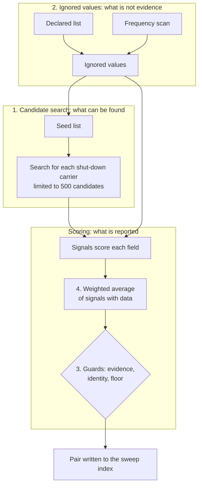

# Tuning an entity matcher: fix the candidate search before the weights

An entity matcher decides whether two listings describe the same real-world
business. Once one runs, it produces a list of likely pairs, and someone notices
a match it missed. The usual response is to lower the threshold or change the
weights. Neither helps when the missing listing never reached the scorer.

[entitopia](https://github.com/freemansoft/entitopia) is an open-source project
for this kind of matching on Elasticsearch. One of its sample projects reads the
US register of motor carriers, about 2.1 million companies. It looks for
carriers that a regulator shut down and that may have reopened under a new name.
Another looks for duplicate listings among 5,419 Medicare hospitals. The carrier
matcher runs in two stages:

1. A candidate search fetches up to 500 listings that might be the same business
   as each shut-down carrier.
2. A Python scorer compares each candidate with the shut-down carrier field by
   field and combines the results into one pair score.

The settings that changed what the matcher found sat in the candidate search and
in the list of values to ignore. Changing the weights moved the output least. [A
companion
article](https://github.com/freemansoft/entitopia/blob/main/docs/blog/2026-08-30-01-finding-the-same-business.md)
measures how to match each field.

The figures come from public US government data downloaded in August 2026.
Expect different values on your own data.

## Terms used in this article

<details>
<summary>Show the terms</summary>

| Term                               | What it means here                                                                                                                                                         |
| ---------------------------------- | -------------------------------------------------------------------------------------------------------------------------------------------------------------------------- |
| Index                              | Elasticsearch's name for a collection of stored listings. It is closer to a database table than to a database index.                                                       |
| Listing                            | One business's record in the register.                                                                                                                                     |
| Shut-down carrier / newer carrier  | The two sides of a pair: a carrier under an out-of-service order, and a later registration that may be the same business.                                                  |
| Candidate search                   | The Elasticsearch query that fetches possible matches for one shut-down carrier. Only candidates are ever scored. Also called blocking.                                    |
| Seed list                          | The configured list of signals allowed to add clauses to the candidate search, built from the shut-down carrier's own values.                                              |
| Candidate limit                    | The most candidates the search returns for one carrier: 500 here (`max_candidates`).                                                                                       |
| BM25                               | Elasticsearch's relevance ranking, which counts rarer words for more. It orders the candidates; it is not the pair score.                                                  |
| Signal                             | One per-field comparison in the scorer, such as name sound codes or a shared phone number. It returns a score from 0 to 1, or no value when either side lacks the field.   |
| Weight                             | A signal's configured share of the pair score.                                                                                                                             |
| Pair score                         | The weighted average of the signals that returned a value, from 0 to 1. It is uncalibrated: 0.9 does not mean a 90% chance of the same business.                           |
| Floor / threshold                  | The lowest pair score a sweep keeps: 0.35 here (`min_total_score`).                                                                                                        |
| Top tier                           | Pairs scoring 0.70 or more, where the project's review starts.                                                                                                             |
| Identity signal                    | A signal that can tie two listings together on its own: name, address, phone, email or vehicle identifier. Timing and a shared filing agent only corroborate.              |
| Evidence source                    | The fields a signal reads. Several signals that read the same fields count as one source.                                                                                  |
| Conclusive signal                  | A signal whose match keeps the pair even when its score falls below the floor.                                                                                             |
| Inverse document frequency         | A rarity score that counts a value for less the more listings carry it.                                                                                                    |
| Filing agent                       | A company that files legal paperwork for carriers. One agent can serve thousands.                                                                                          |
| Vehicle identifier                 | A truck's vehicle identification number (VIN), read from inspection and crash reports.                                                                                     |
| Placeholder                        | A junk value entered where the real one was missing, such as `UNKNOWN` or `(000) 000-0000`.                                                                                |
| Terms aggregation / frequency scan | An Elasticsearch query that counts how many listings carry each value of a field. The frequency scan runs one before scoring to find values too common to identify anyone. |
| `keyword`                          | A field type stored exactly as written, case included, for exact matching.                                                                                                 |
| Sweep                              | One full run of the matcher over every shut-down carrier, writing the pairs it finds to a new index.                                                                       |
| Recall                             | The share of real matches the matcher reports. Measuring it needs a list of known matches, which this project does not have.                                               |
| More terms                         | The project's [README glossary](https://github.com/freemansoft/entitopia/blob/main/README.md#glossary) defines these and the rest of its vocabulary.                       |

</details>

## Search first, then score the results

The candidate search decides what the matcher can find. A list of ignored values
keeps junk like `UNKNOWN`, and values shared by hundreds of carriers, from
counting as a match. The scorer decides what gets reported. A pair the search
never returned cannot reach the scorer, so no threshold or weight can recover
it.

The diagram numbers those three parts in the order to tune them. The
[README](https://github.com/freemansoft/entitopia/blob/main/README.md#inside-entity-match)
draws the same flow with the code's own names.



## The seed list sets the ceiling on what the matcher finds

The candidate search looks for listings that share something with the shut-down
carrier. A configured seed list decides which fields it may use. Here those are
the name's sound codes, address, phone, email and vehicle identifiers. What goes
on that list matters more than any other setting, and choosing it can go wrong
in two opposite ways.

**Adding a common value floods the search.** Pick two carriers at random from
those with a filing agent on file, and they share the agent 6.0% of the time.
Adding the agent to the list would return near-random listings and push real
matches past the 500-candidate limit. The project scores the filing agent but
keeps it off the seed list.

**Leaving out a rare, decisive value hides a whole class of match.** The project
once scored shared vehicle identifiers without seeding on them. A carrier that
changed its name, address and phone but kept its trucks never reached the
scorer. No threshold, weight or candidate limit could find it. Vehicle
identifiers then joined the seed list. Measured on the full dataset, every 400
shut-down carriers searched gained 257 newer carriers that only the vehicle seed
returned.

The test for a seed is a question about the output. If two listings shared only
this value, would you want to see the pair? A yes puts the value on the seed
list, whatever its weight.

A seed can also fail silently. The project's first vehicle seed lowercased each
identifier before searching. The fields use the `keyword` type, which stores
identifiers as filed, in capitals. That field type is case-sensitive, so the
lowercase search would have matched none of them. The signal would have looked
active while adding no candidates. The project caught it before the first sweep
ran. Nothing in the output would have shown it.

## Fetching 500 candidates instead of 100 found no new top matches

Raising the candidate limit from 100 to 500 quadrupled the runtime. It found no
new top-tier pairs, because BM25 already ranked those near the top. It did add
13% more pairs that share a vehicle identifier, all between the floor and the
top tier.

Choosing which 500 to keep paid far more. The search now keeps only listings
registered within the window the scorer accepts, from 180 days before the
shutdown to a year after. It also breaks BM25 ties by a fixed order. A reload of
the index used to move tied candidates across the limit. Measured in November
2026 with the same data and scoring, the change cut the carriers hitting the
limit from 43,111 to 30,989. Top-tier pairs rose from 581 to 819.

The limit still matters: 30,989 of 48,540 shut-down carriers hit it in the
current sweep. Common words in carrier names make that structural. A bigger
number will not fix it; better seeds will.

## Ignore filler values and values too many listings share

Some values look like a match without meaning one. A placeholder such as
`UNKNOWN` or `(000) 000-0000` stands in for a missing value. A correct value can
also sit on hundreds of listings, such as a filing service's email address. The
matcher ignores both kinds. Counts from the current data:

| Value                         | Field              | Listings carrying it | Kind            |
| ----------------------------- | ------------------ | -------------------- | --------------- |
| `GGGG`                        | Vehicle identifier | 158                  | Placeholder     |
| `UNKNOWN`                     | Vehicle identifier | 79                   | Placeholder     |
| A run of seventeen nines      | Vehicle identifier | 52                   | Placeholder     |
| `(000) 000-0000`              | Phone              | 664                  | Placeholder     |
| The most shared email address | Email              | 755                  | Correct, shared |
| 200 email addresses           | Email              | More than 20 each    | Correct, shared |

Two carriers that both filed `UNKNOWN` look like a perfect identity match. The
shared emails are worse, because nothing is wrong with them. A filing service,
an insurance agency or a corporate parent puts its own contact details on every
carrier it serves. The value is correct for each carrier and identifies none of
them.

Cleaning the data cannot fix the second kind. Deleting a correct email destroys
correct data, and the next download brings it back. The matcher ignores these
values at query time instead.

## List the filler values you know, and let a scan find the rest

The matcher collects its ignored values from two sources. An operator lists
known placeholders in the configuration. A scan at the start of each sweep
counts every value and adds any that too many listings share. The candidate
search and the scorer both skip everything on the combined list.

| Source         | Covers                                    | Detail                                                                                  |
| -------------- | ----------------------------------------- | --------------------------------------------------------------------------------------- |
| Declared list  | Placeholders an operator can name         | Keyed by field: `0` is junk as a vehicle identifier but a real street number            |
| Frequency scan | Values nobody knew to declare             | One terms aggregation per field at the start of each sweep                              |
| Scan threshold | How many listings make a value too common | 5 for a vehicle identifier; 20 for a phone, fax or email, since relatives share a phone |

The scan once asked Elasticsearch for at most 200 values per field. Exactly 200
email addresses passed the 20-listing threshold, so one more would have dropped
out with no warning. Raising the limit to 2,000 found 661 over-shared values
among vehicle identifiers from inspection reports. The previous sweep had scored
459 shared vehicle identifiers as identity evidence.

The candidate search needs the same list. Seeding on a placeholder fetches
hundreds of unrelated listings. The vehicle seed reached 4,181 extra carriers
per 400 searched when it ignored nothing, against 257 with the ignored values.
Placeholders like `GGGG` made up 94% of them.

## Missing data is not disagreement

A signal returns no value when either listing lacks the field, and 0.0 when both
have it and they differ. The difference matters. Scoring missing data as 0.0
would punish a carrier for a sparse listing. A blank must never match a blank,
and it must not count against either side.

The scorer averages over only the signals that returned a value, divided by
their weights alone. A pair with data for three of eight signals gets a score
from those three. That keeps sparse listings in play. The current sweep shows
what that costs. The newer carrier has no address on file in 499 of the 819
top-tier pairs. Name and identity signals carry those scores alone.

## Score shared name words with a blend of two formulas

The scorer compares two names by the words they share. Two standard formulas
measure that overlap, and each fails in the opposite direction. Jaccard divides
the shared words by all the distinct words, so it punishes a name that drops a
word. Dropping a word is a cheap way to look different. Containment divides the
shared words by the words in the shorter name, so any subset scores as a perfect
match. One shared word would then count as a full match.

The project takes half of each. `{QUILBY, FREIGHT}` against
`{QUILBY, FREIGHT, LINES}` scores 0.67 on Jaccard and 1.0 on containment, so
0.83 blended. That ranks a dropped word above a partial match and below an
identical name. The
[`blended_overlap`](https://github.com/freemansoft/entitopia/blob/main/matching/tokens.py)
function carries the reason in its docstring.

## The first rarity formula rated every filing agent as rare

Two carriers sharing a filing agent means little when the agent serves thousands
of carriers, and more when it serves a few. One signal therefore gives more
credit the rarer the shared agent is. The first design scored rarity as
`1 - count/N`, where N counts every agent filing. That formula cannot separate
anything on this data. The fault was in the formula, not the signal's weight.

The current data lists 87 distinct agents across 519,139 agent filings on
carrier listings, and the largest serves 12.0% of them. The formula `1 - share`
therefore puts every agent between 0.880 and 1.0. The most common agent and the
rarest score almost alike. Normalized inverse document frequency,
`log(N/count) / log(N)`, spreads the same agents from 0.161 to 1.0.

Exploratory testing caught the error. The design expected a dominant agent to
score near 0.07, while its formula gave about 0.9. A specification precise
enough to contradict itself is worth more than a vague one that stays
consistent.

## The independent-evidence check counted names three times

The scorer runs three pass-or-fail checks before it writes a pair, and the
project calls them guards. A pair fails if it draws on fewer than two
independent evidence sources, or if no identity signal matched. It also fails
below the 0.35 floor, unless a conclusive signal matched. The first check once
counted signals instead of sources. The carrier configuration reads names
through three signals: two sound-code encoders and one word comparison. A pair
that matched on name alone passed a check meant to demand a second source.

```json
"scoring": {
  "min_total_score": 0.35,
  "min_signals": 2,
  "require_identity_signal": true
}
```

That fragment is from
[`entity-match.json`](https://github.com/freemansoft/entitopia/blob/main/DOT-Commercial/configuration/chameleon-detection/entity-match.json),
and
[`scorer.py`](https://github.com/freemansoft/entitopia/blob/main/matching/scorer.py)
applies the checks. Each signal now declares the fields it reads, and the check
counts distinct sources. The key still says signals. The 8 configured signals
resolve to 6 sources.

The check counts sources that had data, not sources that matched. A name-only
pair still passes when a second source had something to compare. The
[README](https://github.com/freemansoft/entitopia/blob/main/README.md#open-work-items)
records the cost on the hospital duplicate sweep: 2,581 of 3,627 pairs matched
on name alone.

## Averaging cannot say "this one fact settles it"

A weighted average dilutes any single signal by the number of others. Usually
that helps. It threw away the strongest evidence the data holds: a shared
vehicle identifier.

The vehicle signal's original weight was 0.08. A pair sharing only a vehicle
identifier scored 1.0 on that signal. The average divides by the weights of
every signal with data, and the others found little. The pair averaged about
0.11, far below the 0.35 floor. None of those pairs survived in a run of 3,000
shut-down carriers. Clearing the floor alone would have needed a weight near
0.46. That weight would let the vehicle signal swamp every other pair it
touched.

The project marks the signal `conclusive` instead. When it matches, the pair
stays even below the floor. That changes only the pairs where this evidence
stands alone. The other guards still apply. The current sweep holds 525 pairs
that rest on a shared vehicle alone. They score 0.17 to 0.25 at today's weight
of 0.16, so the floor would drop every one.

## The output is a review queue, not a verdict

The current sweep wrote 128,907 pairs. Its 118,697 pairs below 0.50 (92.1%) are
noise. The top tier holds 819. The project's review filter narrows it to 200.
Each of those scores 0.70 or more and shares a vehicle, phone or email. The
newer carrier also registered within a year of the shutdown.

The scores carry no tested link to real outcomes. Nobody has labeled which pairs
are the same business. A 0.9 is a ranking, not a probability. A high score
routinely reflects a shared filing agent, a corporate parent or a placeholder
the lists missed. A person reads the queue, and the score decides only the
order.

## Moving weight off names changed little

Three signals read the same two name fields, and together they once carried 0.45
of a 0.94 total. The ranking came out backwards. One pair had a byte-identical
street in the same state, and the newer carrier registered 45 days after the
shutdown. It scored 0.3483 and fell below the floor. Another pair shared one
common word in its names, sat in different states and shared nothing else. It
scored 0.5113, and the sweep reported it.

The fix moved 0.15 off names onto the phone-and-email signal and the vehicle
signal, keeping the total at 0.94. Measured in August, before the search change
above, top-tier pairs rose from 596 to 611. Pairs with byte-identical names in
the review filter fell from 153 to 145; all 8 lost pairs had scored just above
0.70. A secondary check, whether higher-scoring newer carriers crash more often,
showed no gain. The [DOT-Commercial
README](https://github.com/freemansoft/entitopia/blob/main/DOT-Commercial/README.md#closed-work-items)
records the full before and after.

The weight change fixed a visible wrong ranking. It moved the top tier by 15
pairs.

## What to tune, in order

1. **The candidate search.** Count how many searches hit the candidate limit.
   Check which signals may seed. This sets the ceiling, and nothing downstream
   raises it.
2. **The ignored values.** Run a terms aggregation on every field you treat as
   identity evidence, and read the most common values before trusting any.
3. **The guards.** Confirm they count independent evidence, not signals.
4. **The weights.** They are the most visible setting and moved the least.

## Source

The code, configuration and measurements behind this article are in the
[entitopia repository on GitHub](https://github.com/freemansoft/entitopia). The
[README](https://github.com/freemansoft/entitopia/blob/main/README.md#inside-entity-match)
describes the matcher, and the [DOT-Commercial
README](https://github.com/freemansoft/entitopia/blob/main/DOT-Commercial/README.md#chameleon-detection-tuning)
records each tuning measurement.
