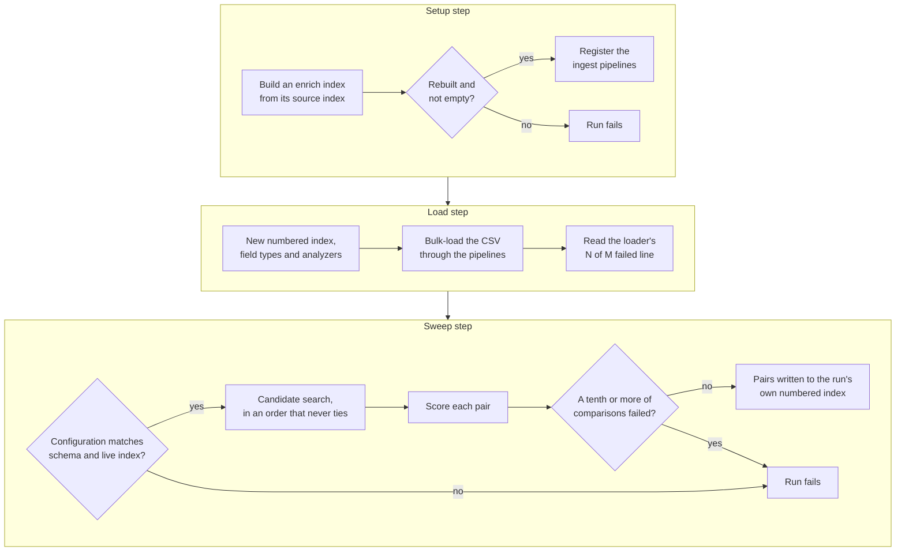

# Building a general entity matcher: test it on a second dataset

Entity resolution decides whether two listings from different sources describe
the same real-world business. The listings share no key, and their names and
addresses rarely match letter for letter. The same problem turns up in customer
master data, supplier deduplication, provider directories and fraud detection.

[entitopia](https://github.com/freemansoft/entitopia) is an open-source project
for this kind of matching on Elasticsearch. It keeps everything specific to a
dataset in JSON configuration. One sample project reads the US register of motor
carriers, about 2.1 million companies. It looks for carriers that a regulator
shut down and that may have reopened under a new name. Another looks for
duplicate listings among 5,419 Medicare hospitals.

We used the hospital project as a test dataset to see if we could do entity
matching only with configuration. It partially worked. Testing with the hospital
data found four defects in shared code that the carrier data had never
triggered. Each one is now fixed, and the hospital sweep runs from four
configuration files. Every failure in this article shares one signature: the run
reported success, and the data was quietly wrong.

[Use Elasticsearch to match businesses](https://joe.blog.freemansoft.com/2026/11/use-elasticsearch-to-match.html)
measures how to compare each field.
[Tuning an entity matcher](https://joe.blog.freemansoft.com/2026/11/tuning-entity-matcher-fix-candidate.html)
measures what the candidate search and the ignored values let the scorer see.
This article covers what it took to run the same matcher on a second dataset,
and how to trust a run.

The figures come from public US government data downloaded in August 2026.
Expect different values on your own data.

## Terms used in this article

<details>
<summary>Show the terms</summary>

| Term                              | What it means here                                                                                                                                       |
| --------------------------------- | -------------------------------------------------------------------------------------------------------------------------------------------------------- |
| Listing                           | One business's record in a source dataset. Elasticsearch stores each one as a document.                                                                  |
| Index                             | Elasticsearch's name for a collection of stored documents. It is closer to a database table than to a database index.                                    |
| Alias                             | A stable name that points at one index, so a rebuilt index can replace the old one without changing the name the code uses.                              |
| Mapping                           | An index's schema: which fields it has, each field's type, and which analyzer processes each one.                                                        |
| Analyzer                          | Elasticsearch's rules for turning text into the pieces it stores and searches: split into words, lowercase, drop punctuation, encode sounds.             |
| Ingest pipeline                   | Elasticsearch processing that transforms each document as it loads.                                                                                      |
| Enrich policy / enrich index      | Elasticsearch's way to copy fields from one index into documents of another as they load, like a join done at load time. The enrich index is its lookup. |
| Project / step / phase            | A project is a directory of configuration and data. It runs steps in order, and each step runs phases such as creating an index or loading data.         |
| Population                        | The listings a sweep starts from: every listing, or those a configured rule selects.                                                                     |
| Shut-down carrier / newer carrier | The two sides of a carrier pair: a carrier under an out-of-service order, and a later registration that may be the same business.                        |
| Candidate search                  | The Elasticsearch query that fetches possible matches for one listing. Only candidates are ever scored.                                                  |
| Seed list                         | The configured list of signals allowed to add clauses to the candidate search.                                                                           |
| Candidate limit                   | The most candidates the search returns for one listing: 500 for carriers (`max_candidates`).                                                             |
| BM25                              | Elasticsearch's relevance ranking. It orders the candidates; it is not the pair score.                                                                   |
| Signal                            | One per-field comparison in the scorer, such as name sound codes or a shared phone number. It returns a score from 0 to 1, or no value.                  |
| Weight                            | A signal's configured share of the pair score.                                                                                                           |
| Pair score                        | The weighted average of the signals that returned a value, from 0 to 1.                                                                                  |
| Guard                             | A rule a pair must pass to be kept, such as a minimum number of independent evidence sources.                                                            |
| Conclusive signal                 | A signal whose match keeps the pair even when its score falls below the lowest score a sweep keeps.                                                      |
| Ignored values                    | Placeholders such as `UNKNOWN`, and values too many listings share, which the search and the scorer both skip.                                           |
| Entity key                        | The field that identifies one listing, such as a carrier's DOT number.                                                                                   |
| Sweep                             | One run of the matcher over a population, writing the pairs it keeps to a new index.                                                                     |
| Filing agent                      | A company that files legal paperwork for carriers. One agent can serve thousands.                                                                        |
| Fingerprint field / filter field  | A fingerprint field can identify one business. A filter field has so few distinct values that it can only narrow a population.                           |
| Regression test                   | An automated test that fails if a fixed defect returns.                                                                                                  |
| More terms                        | The project's [README glossary](https://github.com/freemansoft/entitopia/blob/main/README.md#glossary) defines these and the rest of its vocabulary.     |

</details>

## Fraud detection and deduplication ask the same question

Both projects ask whether two listings describe the same business. The carrier
project asks it about a carrier a regulator shut down and a carrier that
registered soon after. A match there may mean the business reopened under a new
name. The hospital project asks it about any two hospitals. A match there may
mean one hospital is listed twice.

The same code answers that question for both projects. Each sweep picks the
listings to start from. It searches for possible matches for each one, then
scores each pair. The carrier sweep starts from shut-down carriers and searches
only listings registered near the shutdown. The hospital sweep starts from every
hospital. Configuration holds those choices, along with the fields to compare
and their weights. The search and the scoring are code.

## Seven phases read each step's configuration from JSON

A project is a directory of configuration and data. Running it executes steps in
order, and each step runs some of seven phases. The phases hold no knowledge of
any dataset. Each step's JSON files name the index to build, its field mappings
and what to match.

| Phase                 | What it does                                                                                                    |
| --------------------- | --------------------------------------------------------------------------------------------------------------- |
| `index-create`        | Creates the day's next numbered index and points the step's alias at it                                         |
| `index-map`           | Applies field types and analyzers                                                                               |
| `validate`            | Checks the configuration against its schema and against the live index mapping, and stops the run on a mismatch |
| `enrichment-policies` | Builds the enrich indexes that copy fields between indexes during loading                                       |
| `pipelines`           | Registers the ingest pipelines documents pass through as they load                                              |
| `index-populate`      | Bulk-loads a CSV file, optionally through a pipeline                                                            |
| `entity-match`        | Runs a sweep: searches for candidates, scores each pair, and writes the pairs it keeps                          |

Elasticsearch cannot change an analyzer on a live index, so a reload builds a
new index and moves the alias. The diagram shows the carrier project's three
kinds of step in run order, with the checks that now stop the failures below.
The hospital load steps also run `validate` first.



## Two datasets test different halves of the framework

| Project  | Loads                                        | Matches                                                      | Exercises                                                                    |
| -------- | -------------------------------------------- | ------------------------------------------------------------ | ---------------------------------------------------------------------------- |
| Carrier  | About 25 million rows across seven datasets  | About 2.1 million carriers, from shut-down to newer carriers | Two-level enrichment, ingest pipelines, a succession sweep                   |
| Hospital | About 5.6 million rows across three datasets | 5,419 hospitals, each against its candidates                 | Column names with spaces, no enrichment, a duplicate sweep with no direction |

One dataset lets an assumption about that dataset hide inside shared code. A
second dataset forces a question about every line: does this belong to the
engine, or to one dataset? The carrier project needs a two-level enrichment
chain, from vehicle records to inspections to carriers. The hospital project
needs none. Code that only one project needs belongs in configuration. The
defect sections below report how well the split held.

## Configuration picks signals from a fixed set of Python classes

Configuration selects each signal by a type string and sets its fields and
weight. This block ships today in the carrier project's
[`entity-match.json`](https://github.com/freemansoft/entitopia/blob/main/DOT-Commercial/configuration/chameleon-detection/entity-match.json):

```json
{
  "type": "shared-token",
  "name": "vin-overlap",
  "weight": 0.16,
  "conclusive": true,
  "max_shared_entities": 5,
  "fields": [
    "crashes.vehicle_identification_number",
    "inspections.units.insp_unit_vehicle_id_number"
  ]
}
```

Each signal class registers its own type name, and `build_signal` looks it up. A
new kind of evidence needs a new class with unit tests, not a new block of JSON.
The candidate search code once kept its own list of the types allowed to fetch
candidates. It also held query code for phone numbers and vehicle identifiers.
Each signal now answers for itself. Its `seed_clauses()` method says what to
search for. Its `token_subfields()` method says which analyzed text to fetch.
The candidate search combines the answers and holds no code for any one signal.
[Tuning an entity matcher](https://joe.blog.freemansoft.com/2026/11/tuning-entity-matcher-fix-candidate.html)
measures why the seed list matters more than any weight.

The vehicle signal shows where the line between code and configuration falls. It
shipped as `vin-overlap`, but nothing in its logic concerns vehicles. It asks
whether two listings name the same physical thing by an identifier that is
unique worldwide. A container number, an aircraft tail number or a serial number
works the same way. The class became `SharedTokenSignal`, registered as
`shared-token`, and the project deleted the old type name. The word
`vin-overlap` survives only as the signal's `name`, which every written pair
carries.

A component that still makes sense without its domain word belongs in code. One
that does not belongs in configuration. The population selector failed the same
test. It began as a predecessor selector, a name that presumed every sweep looks
for successors. A duplicate search has a population but no predecessors, so the
class became `PopulationSelector`.

Configuration picks from a closed menu and cannot write its own query.
Population rules come from four clause kinds: `nested-exists`, `term`, `all` and
`any`. Free combination would let a project rebuild a defect the carrier project
already hit. The wrong mapping once let an active 2015 order and an inactive
2022 order jointly pass a filter that neither order passed alone.

## A field with few distinct values cannot identify a business

A profiler script measures each column before anyone configures matching on it.
It reports distinct counts, blank rates, date formats, mixed types, leading
zeros, and whether a key is unique. It also sorts columns into fingerprint
fields and filter fields. The profiler prints how often two unrelated rows share
a value by chance, for a column with few distinct values and one common value.

The filing-agent column shows why that estimate matters. The project's
documentation once called the agent harder to fake than an address. The profiler
found 89 distinct agents across 1.43 million rows, so two unrelated rows share
one about 6% of the time. The agent now ships as a rarity-weighted signal at
weight 0.04, not as strong evidence.
[Tuning an entity matcher](https://joe.blog.freemansoft.com/2026/11/tuning-entity-matcher-fix-candidate.html)
measures why the first rarity formula still rated every agent as rare.

A field that two random rows share more than about 1% of the time cannot carry a
match. Weight it by rarity, or use it only to narrow a population.

## Five loading failures reported success

The failures in this section and the next two share the article's signature.
None raised an error at the time.

| Failure                | What was wrong                                                                                                                         | Fix                                                             | Regression test                                                |
| ---------------------- | -------------------------------------------------------------------------------------------------------------------------------------- | --------------------------------------------------------------- | -------------------------------------------------------------- |
| Inferred field types   | Elasticsearch typed a carrier ID as a number in one index and as exact text in another. A lookup joining them matched zero documents.  | Map every field the code relies on                              | `test_dot_number_join_contract.py`                             |
| Two-digit years        | Mapping `01-JUN-74` with a two-digit year format turned 1974 into 2074.                                                                | Convert dates during loading, with an explicit century          | Partly: `test_signals.py` pins the century rule for the scorer |
| Renamed columns        | The source renamed its columns. The analyzers named the old ones and never ran.                                                        | `validate` checks every configured field against the live index | `test_config_liveness.py`                                      |
| A stale enrich index   | An enrich index stayed pinned to a 5,000-row test sample through a full load. Coverage fell from about 572,000 matches to about 4,000. | A stale or empty enrich index now fails the run                 | `test_phase_enrichment_policies.py`                            |
| Rejected bulk requests | A busy cluster rejected 91,439 of 2,085,534 documents (4.4%). The tuning had gone to a different queue, which showed no rejections.    | Size the queue the loader uses                                  | None. Read the loader's line                                   |

The last failure hid in plain sight. Every dataset uses a fixed document ID per
row, so an index holding fewer documents than its CSV has rows is normal. A load
that lost 91,439 documents looked like a load that removed duplicates.

The first two articles met the same signature.
[Use Elasticsearch to match businesses](https://joe.blog.freemansoft.com/2026/11/use-elasticsearch-to-match.html)
describes an address that never matched its comma-free copy, because of a
doubled space.
[Tuning an entity matcher](https://joe.blog.freemansoft.com/2026/11/tuning-entity-matcher-fix-candidate.html)
describes a vehicle seed that would have looked active while adding no
candidates.

## The hospital project exposed four defects the carrier project never triggered

The hospital project was the first test of matching with configuration alone. Its duplicate sweep runs from four configuration files. It
also exposed four defects in shared code. Every one ended in a run that reported
success.

| Defect                               | What the run reported                    | What was wrong                                                                                                                                                      | Fix                                                                                    |
| ------------------------------------ | ---------------------------------------- | ------------------------------------------------------------------------------------------------------------------------------------------------------------------- | -------------------------------------------------------------------------------------- |
| Field names containing a space       | 116 plausible pairs, 0 errors            | The token fetch dropped every field whose name contains a space. The name signals never ran, so every pair had matched on address alone.                            | Send the field list per document. The same configuration then found 4,751 pairs.       |
| A setting the schema called optional | 532,529 errors, 0 pairs, then "complete" | The address signal required `fuzzy_scale`, which the schema let a project leave out.                                                                                | The schema now requires it, with no silent default.                                    |
| A sweep in which every pair failed   | `entity-match complete`, exit code 0     | The sweep counted and logged each error and did nothing else.                                                                                                       | The sweep now fails when a tenth or more of its comparisons fail.                      |
| A hard-coded state column            | 3,698 plausible pairs                    | The address signal read `phy_state`, the carrier project's column. Hospitals store `State`, so every pair looked cross-state and lost half its fuzzy address score. | A required `state_field` setting. A missing state no longer counts as a different one. |

Every carrier column name is in snake_case, which is the only reason the first
defect survived the carrier sweeps. The fourth outlasted the other three by
nearly three months, because the signal still returned a believable score. Its
fix raised 185 hospital pair scores and lowered none. The hospital comparison in
[Use Elasticsearch to match businesses](https://joe.blog.freemansoft.com/2026/11/use-elasticsearch-to-match.html)
ran before this fix, from 3,698 pairs.

The first hospital sweep, in August, exposed three of the defects. A review for
this blog series found the fourth in November. Each fix has a regression test.

## Three kinds of re-run damaged the earlier run

Anyone tuning a matcher compares each run with the one before. Three re-runs
destroyed or changed the earlier run before that comparison.

| Re-run                         | What happened                                                                                                                                                   | Fix                                                                         | Regression test                     |
| ------------------------------ | --------------------------------------------------------------------------------------------------------------------------------------------------------------- | --------------------------------------------------------------------------- | ----------------------------------- |
| A second sweep on the same day | Both runs resolved to one index name. A sweep that wrote 3,627 pairs left 7,347: its own, plus 3,720 that only the earlier run had written.                     | Each run takes the day's next numbered index                                | `test_dated_index_generations.py`   |
| Re-creating a results index    | The alias moved to a new, empty index and hid every recorded validation run.                                                                                    | Configuration can mark an index `persistent`, so a re-run keeps it          | `test_rerun_guards.py`              |
| Reloading unchanged data       | The carrier sweep lost 2,234 pairs and gained 1,793. Candidates tied on BM25 at the 500th place fell either side by storage order, which changes on every load. | Sort by BM25, then by registration nearest the shutdown, then by entity key | `test_candidate_retrieval_order.py` |

The reload took a pair-by-pair comparison to explain. More than 500 listings
matched in 89% of carrier searches before the fix, so the candidate limit cut
most searches short. Each of the 16 lost pairs scoring 0.60 or more sat in a tie
that spanned the 500th place. Those ties ran from 104 to 619 listings. The new
order never ties, so the same data returns the same candidates.
[Tuning an entity matcher](https://joe.blog.freemansoft.com/2026/11/tuning-entity-matcher-fix-candidate.html)
measures what choosing which 500 to keep did to the top-scoring pairs. All three
regression tests run on every pull request.

## What to decide first on a new dataset

1. **Pick the population.** Decide which listings a sweep starts from: every
   listing, or a subset with a reason for suspicion. A subset costs less, and no
   framework can choose it for you.
2. **Profile every field before you weight it.** Read the profiler's fingerprint
   and filter split before trusting any field as evidence.
3. **Choose the seed list, the ignored values and the guards.** Follow the
   tuning order at the end of
   [Tuning an entity matcher](https://joe.blog.freemansoft.com/2026/11/tuning-entity-matcher-fix-candidate.html).
4. **List `validate` in every step.** A field the configuration names and the
   index lacks then stops the run before any work.

## Check a run before trusting it

- **Ask the cluster what the run did.** Compare an enrich index's count with its
  source, and read the loader's "N of M documents failed" line.
  [Use Elasticsearch to match businesses](https://joe.blog.freemansoft.com/2026/11/use-elasticsearch-to-match.html)
  applies the same rule to analyzers.
- **Run a second dataset through the shared code.** Even a small one exposes
  assumptions the first dataset hides.
- **Re-run the first dataset on unchanged data.** Compare the two runs pair by
  pair. Any difference needs an explanation.

## Source

The code, configuration and measurements behind this article are in the
[entitopia repository on GitHub](https://github.com/freemansoft/entitopia). The
[README](https://github.com/freemansoft/entitopia/blob/main/README.md#common-data-loading-hazards)
records each loading failure with its regression test, and its
[closed work items](https://github.com/freemansoft/entitopia/blob/main/README.md#closed-work-items)
record the hospital project's defects.
[Adding a dataset](https://github.com/freemansoft/entitopia/blob/main/docs/adding-a-dataset.md)
walks through configuring a new one.
